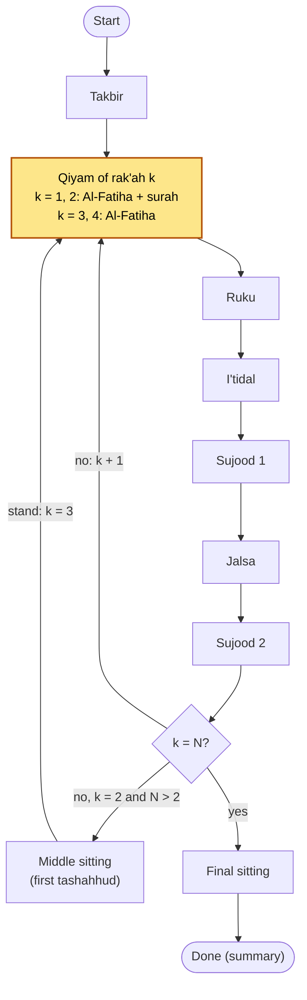

# Salah Companion — Product & Technical Spec

Status: draft v0.3 (all five fard prayers), extended 20 Oct 2026 from v0.2 (Fajr pilot, reviewed 18 Oct 2026). Maintained in this repo; propose changes by pull request.

## Overview

Salah Companion is a Flutter app that watches the person praying through the phone camera. When it confirms they are standing in qiyam, it recites Al-Fatiha and then one surah aloud, and the person recites along with it. It is built for Muslims who know few surahs: new Muslims, people returning to prayer, and anyone building their memorisation.

The app covers the five fard prayers: Fajr (2 rak'ahs), Dhuhr (4), Asr (4), Maghrib (3) and Isha (4). Audio plays only during qiyam: in rak'ahs 1 and 2 it is exactly two recitations, Al-Fatiha then a surah; in rak'ahs 3 and 4 it is Al-Fatiha alone. The app is free and works fully offline. It never records video and collects no data. (Fajr was the first pilot; the logic, synthetic data and replay harness now cover all five.)

This spec has been through one round of agent review; the review log at the end lists what changed. Section 9 splits the work into workstreams that agents can own.

## Scope

The app does one thing well: it reliably recites Al-Fatiha and a surah in rak'ahs 1 and 2, and Al-Fatiha in rak'ahs 3 and 4, of each fard prayer, played at the right moment and never at the wrong one.

| Area | In the pilot | Out of the pilot (later) |
| --- | --- | --- |
| Prayers | The five fard prayers: Fajr (2 rak'ahs), Dhuhr (4), Asr (4), Maghrib (3), Isha (4), chosen by the user at start. Fajr sunnah has the same structure as Fajr; whether it plays a surah is for the religious reviewer (Maliki practice is Al-Fatiha only) | Witr, other sunnah and nafl prayers, qasr (shortened) travel prayers, combined prayers |
| Audio | Al-Fatiha + one surah in the qiyam of rak'ahs 1 and 2; Al-Fatiha alone in rak'ahs 3 and 4. Recited aloud the same way in the silent prayers (Dhuhr, Asr), pending religious review (section 8) | Takbir, ruku and sujood tasbih, tashahhud, salawat, salam |
| Detection | Standing, bowing, prostrating and sitting from the camera; rak'ah counting | Correcting mistakes, sajdah sahw, telling the user they missed a step |
| Content | One reciter; Al-Fatiha + a curated list of short surahs from Juz 'Amma, bundled offline | Several reciters, any surah (still bundled offline) |
| Practice mode | Should have: play a surah outside prayer with Arabic, transliteration and translation | Memorisation tracking, quizzes |
| Platforms | Android first; iOS from the same Flutter codebase once Android passes field testing | Wear OS, smart mats |
| People in frame | One person praying alone | Congregation, several people in frame |
| Accounts | None; settings stored on the device | Sign-in, sync |

## User experience

The user sets things up once, props the phone up, and prays. During the prayer they never touch or look at the phone.

### First-time setup

1. **Welcome and intent.** Explain in one screen that the app is a companion while the user learns their surahs, that it works for all five daily prayers, and that they recite along with it.
2. **Permissions.** Ask for the camera, explaining it is processed on the phone and never recorded. Suggest a do-not-disturb mode that still allows media audio (Android "Priority only" with media allowed; an iOS Focus that allows this app).
3. **Surah choice.** Pick a surah for rak'ah 1 and for rak'ah 2, or choose Auto (a reviewer-approved rotation of pairs, section 7).
4. **Opening dua.** Choose the pause before Al-Fatiha in rak'ah 1: None (0 s), Short, for Subhanaka (6 s, default), or Long, for Wajjahtu (18 s).
5. **Pace.** Choose the gap after each ayah, from 0 to 3 seconds (default 1.5 seconds).
6. **Audio check.** Media volume must be above zero to continue. Bluetooth audio shows a warning, because its delay can push audio past the moment the user bows.
7. **Placement guide.** Show where to put the phone (below) and run a live check.

### Placing the phone

- Stand the phone **in portrait**, level, at about hip height (0.8 to 1.0 m), 2 to 3 metres away and side-on to the user. A cheap stand or a shelf works. In rooms under 2.5 m deep, use the ultra-wide camera where the phone has one.
- The **back camera is recommended** (the default): it sees better in dim rooms, and usually has a wider view. The **front camera is allowed** (Settings → Camera, or the flip button on the placement screen): the user can then see themselves on the screen while placing the phone. Front cameras often have a narrower view, so the phone may need to go further back; the check is the same for both cameras and still needs the whole body, head to feet, in view. If the phone lacks the chosen camera, the other one is used.
- A side view is required. From the front, ruku and standing look alike and sujood hides the body.
- The live check passes only when the near-side shoulder, hip, knee and ankle average a confidence of 0.7 or more for 3 s, the camera delivers 15 fps or more for 3 s, and there is floor space in front of the user for sujood: at least 0.6× their height ahead of the toes, judged from the nose–ear direction over the last 15 frames and the best of the last second (head and shoulders must stay in view; fingertips may leave it).
- The user can't see the screen from the prayer mat, so spoken prompts and a tone guide them ("Move the phone back", then a tone when it passes).
- The app notes the phone's tilt when Start is tapped. If the phone moves more than 5° during the session, the app treats it as lost tracking.

### During the prayer

1. The user checks the prayer named on the button (**Start Dhuhr**, for example; guessed from the clock, one tap on the row below changes it) and taps it. The placement screen repeats it ("Dhuhr · 4 rak'ahs") and the spoken countdown names it, because the app follows the chosen prayer's rak'ah count. Once the placement check passes, a 5-second countdown starts by itself, giving them time to step onto the prayer mat. Standing there first, for example to say the iqamah, triggers nothing.
2. The screen dims to near black and stays awake and dark until the prayer ends. The app only watches posture; it never listens.
3. Rak'ah 1: the app needs to see the takbir hand raise, then steady standing. It waits for the chosen opening-dua pause (default 6 s), then recites Al-Fatiha. **If the takbir isn't seen, rak'ah 1 stays silent**, and the app still counts the rak'ah.
4. After Al-Fatiha, a pause (the ayah gap plus 1.5 s) leaves time to say Ameen. Then the app recites the chosen surah and goes silent.
5. Ruku and sujood have no audio. When the user stands for rak'ah 2, the app waits 1.5 s, then recites Al-Fatiha and the second surah the same way. In Dhuhr, Asr, Maghrib and Isha the middle sitting after rak'ah 2 has no audio; when the user stands for rak'ah 3 (and 4), the app waits 1.5 s, then recites Al-Fatiha alone.
6. Final sitting, salam and any sujood al-sahw have no audio. The summary ("Fajr completed · 2 rak'ahs", "Isha completed · 4 rak'ahs") appears only when the user gets up from the final sitting, or after 3 minutes of sitting.

### Following along

The user recites at the same time as the app, not after it. The app supports this in three ways:

- **A slow, clear reciter** chosen for following along (section 7).
- **Gaps between ayahs** that the user sets. The audio is never sped up or stretched, because that distorts tajweed.
- **Early stop.** If the user starts to bow before the surah ends, the fade begins within 0.5 s of them leaving standing and takes 300 ms, without waiting for the bow to be confirmed.

### Practice mode (should have)

Outside prayer, the user can play any surah in the list with Arabic text, transliteration and translation, repeating ayah by ayah. This is where learning happens. During prayer, nothing is shown on screen.

### Screens and visual style

The whole app has four screens, each with one obvious action. Inspired by Gemini Live: dark, calm and full-screen, but stiller, because nothing should move at the edge of the user's vision while they pray.

| Screen | What's on it | Notes |
| --- | --- | --- |
| Home | One large round **Start &lt;Prayer&gt;** button in the centre ("Start Dhuhr"); under it a row of the five prayer names (Fajr Dhuhr Asr Maghrib Isha), the selected one highlighted, one tap switches; a small settings icon and a small practice icon in a corner; one quiet line with today's surahs ("Ad-Duha · Ash-Sharh") | The default prayer is guessed from the phone's clock, with no location: Fajr 03:00–09:59, Dhuhr 10:00–15:29, Asr 15:30–17:59, Maghrib 18:00–19:29, Isha 19:30–02:59. Fajr's window is wide on purpose: offering a 4-rak'ah prayer to someone praying Fajr is the harmful mistake (getting up after the salam would be taken for rak'ah 3), and Fajr starts before 03:30 in summer and is prayed until about 08:00 in winter at high latitudes. A manual pick is kept (in memory) until the clock enters another window. Setup lives in settings after the first run |
| Placement | Full-screen camera preview with the detected skeleton; the chosen prayer at the top ("Dhuhr · 4 rak'ahs"); one status line ("Move the phone back") plus spoken prompts; a small flip-camera button (top right, "Switch camera") that switches between the back and front camera live and saves the choice | When the check passes, the countdown starts by itself, so the user doesn't walk back to tap. The spoken countdown names the prayer ("Step onto your mat for Dhuhr, 4 rak'ahs"), because the session follows the chosen prayer blindly: praying 2 rak'ahs in a Dhuhr session would recite Al-Fatiha when the user stands after salam |
| Prayer | Pure black (OLED pixels off). One tiny, very dim dot shows tracking: steady when fine, amber when lost | No text, no animation, no sounds or vibration except the recitation. Long-press anywhere to end, so a brush or tap can't stop it |
| Summary | "&lt;Prayer&gt; completed · N rak'ahs" with the rak'ahs counted ("Maghrib completed · 3 rak'ahs") and one Done button | Appears only after the user gets up; returns to Home by itself after 30 s |

Settings (reached from Home's settings icon) holds the setup choices plus a **Camera** choice: Back camera (recommended, default) or Front camera, with one line: the back camera sees better in dim rooms; the front lets you see yourself while placing the phone. The front preview is shown mirrored, like a mirror, and the skeleton overlay is mirrored with it; the landmarks used by the prayer logic never are.

An optional "soft glow" setting (off by default) can show a slow, dim breathing light during prayer, for users who like the Gemini Live feel. The default stays black: at Fajr the room is dark, and even a dim animation draws the eye.

## Prayer logic

The app plays audio only when the prayer state machine enters **Qiyam** of a rak'ah. Standing on its own is never enough. The standing after ruku (i'tidal), getting up after the salam, and standing up from the middle sitting all look alike to the camera, and only the sequence tells them apart.

The logic covers the five fard prayers. The user picks the prayer when starting; the machine takes its rak'ah count N from it:

| Prayer | Rak'ahs (N) | Middle sitting |
| --- | --- | --- |
| Fajr | 2 | No |
| Dhuhr | 4 | After rak'ah 2 |
| Asr | 4 | After rak'ah 2 |
| Maghrib | 3 | After rak'ah 2 |
| Isha | 4 | After rak'ah 2 |

### Sequence

Takbir → for each rak'ah k = 1..N: Qiyam → Ruku → I'tidal → Sujood → Jalsa → Sujood; after rak'ah 2 when N > 2: Middle sitting (first tashahhud) → stand for rak'ah 3; after rak'ah N: Final sitting (tashahhud) → Salam. Variations the logic must tolerate: qunut (Fajr: Shafi'i in the i'tidal of rak'ah 2, Maliki before the ruku of rak'ah 2), raising the hands at ruku, raising the hands when standing up from the middle sitting (Shafi'i, Hanbali), a brief sitting before standing for rak'ah 2 or 4 (jalsat al-istiraha), a short or long middle tashahhud, and sujood al-sahw at the end.



The loop runs N times. The states do not depend on the rak'ah: the machine keeps the current rak'ah k and reports it with every state change. Only standing that follows the takbir (rak'ah 1), the first standing after a prostration of the previous rak'ah (rak'ahs 2 and 4), or the first standing after the middle sitting (rak'ah 3) counts as Qiyam. That is why I'tidal never triggers audio.

### States

| State | Posture seen | Entered when | Audio |
| --- | --- | --- | --- |
| Waiting | Any | Countdown ends. Standing here, however long, triggers nothing | None |
| Takbir | Hand raise | A takbir hand-raise event (section 6). Reachable only from Waiting, and not within 5 s of a sitting or prostrating reading (that raise is someone standing up from a sitting, not an opening takbir) | None |
| Qiyam, rak'ah 1 | Standing | Standing held 0.8 s after Takbir, passing the hip-height check (section 6) | Opening-dua pause, then Al-Fatiha → Ameen gap → surah 1 (paused during blind spots, see the rules) |
| Ruku | Bowing | Bowing held 0.5 s, counting only frames whose hip height is at least 0.8× standing (or unknown): rising from sujood looks like bowing with the hips still low. If the takbir was missed, Ruku of rak'ah 1 is entered straight from Waiting and rak'ah 1 stays silent (in a 3- or 4-rak'ah prayer the rest recite only if the user was first seen standing, see the rules) | None (audio already stopped when the user left standing) |
| I'tidal | Standing | Standing after Ruku | None |
| Sujood (and Jalsa) | Prostrating, sitting | Any prostration held 0.5 s after Ruku or I'tidal (same rak'ah). Also Waiting → Sujood of rak'ah 1 (takbir and ruku both unseen, filled in): a prostration held 0.5 s in Waiting enters Sujood with Ruku and I'tidal filled in, so the user's real rak'ah 2 is never counted as rak'ah 1 (in a 3- or 4-rak'ah prayer the count is then uncertain, see the rules). A bow on the way down (hands-first descent) changes nothing | None |
| Qiyam, rak'ahs 2 and 4 | Standing | First standing held 0.8 s after any prostration in the previous rak'ah, passing the hip-height check (section 6) | 1.5 s pause, then Al-Fatiha → Ameen gap → surah 2 (rak'ah 2), or Al-Fatiha alone (rak'ah 4), paused during blind spots |
| Middle sitting (N > 2) | Sitting | Sitting held 3 s after any prostration in rak'ah 2. Unknown or unseen readings totalling 1 s or less do not reset the hold; any other posture does. A jalsa of 3 s or more already enters it; the second prostration is then ignored | None |
| Qiyam, rak'ah 3 (N > 2) | Standing | First standing held 0.8 s after the Middle sitting, passing the hip-height check. A hand raise while standing up is ignored. **If the middle sitting was never confirmed** (too short, or unseen), standing held 0.8 s after rak'ah 2's prostrations still enters Qiyam of rak'ah 3, but silently | 1.5 s pause, then Al-Fatiha alone |
| Final sitting | Sitting | Sitting held 5 s after any prostration in rak'ah N. Unknown or unseen readings totalling 1 s or less do not reset the hold; any other posture (standing, bowing, prostrating) does | None |
| Done | Any | After Final sitting: the user stands up (standing held 0.8 s, passing the hip-height check), sitting lasts over 180 s, or the user is out of frame over 10 s. Also from Sujood of rak'ah N when the final sitting was never confirmed: sitting held 3 s (same gap tolerance) after the last prostration, then standing held 0.8 s (the Final sitting is filled in) | None; show summary |

Each rak'ah's recitation starts at most once (`StartRecitation(k)`, k = 1..N). What it plays is set by the rak'ah alone (section 7): Al-Fatiha and a surah in rak'ahs 1 and 2, Al-Fatiha only in rak'ahs 3 and 4, in every prayer, including the silent prayers Dhuhr and Asr (the user's choice; see the religious review, section 8).

### Rules the state machine follows

- **Anchors, not a strict chain.** States only move forward, but they advance on postures that can't be mistaken. A prostration closes the standing part of a rak'ah, and the first confirmed standing after a prostration of rak'ah k − 1 is Qiyam of rak'ah k, except after rak'ah 2 of a 3- or 4-rak'ah prayer, where the middle sitting comes first and Qiyam 3 is the first confirmed standing after it. A missed ruku, i'tidal or jalsa is filled in, so one missed posture never leaves the machine stuck; a prostration seen while still in Waiting (takbir and ruku both unseen) enters Sujood of rak'ah 1 with Ruku and I'tidal filled in. A bow seen where a Qiyam was expected enters the next Ruku silently.
- **Rak'ah 1 is only ever entered from Waiting or Takbir,** so no later standing can be taken for rak'ah 1, and a Qiyam of rak'ah 3 or 4 can only follow rak'ah 2's prostrations.
- **Takbir only once.** Takbir is reachable only from Waiting. Raised hands later (at ruku, in qunut in either position, or when standing up from the middle sitting) are ignored.
- **Silence when the count is in doubt.** Missing a recitation is acceptable; reciting Al-Fatiha in a sitting, an i'tidal or after the salam is not. So:
  - *Middle sitting not confirmed* (N > 2): rak'ah 3 is counted but not recited (above). The user is most likely in rak'ah 3, so rak'ah 4 can still recite, but without the anchor the machine cannot rule out having counted one rak'ah too many. If it did, the real middle sitting shows up later as a long sitting where none belongs (next point).
  - *A long sitting where none belongs*: sitting held 8 s in the Sujood of a rak'ah k < N other than rak'ah 2 of a 3- or 4-rak'ah prayer means a tashahhud the machine did not expect (it has lost a rak'ah). The hold tolerates gaps like the middle and final sitting holds (unknown or unseen readings totalling 1 s or less do not reset it; any other posture does), so dropout frames during a tashahhud cannot hide it. A jalsa (even a long one of 5–6 s) or a brief sitting before standing is under 8 s.
  - *Untrusted entry* (3- and 4-rak'ah prayers): without a takbir, the count is trusted only when the user is first seen standing (standing held 0.8 s in Waiting before any sitting or prostration held 0.5 s, and none since) and then bows: rak'ah 1 stays silent and the rest recite, as for a missed takbir. A prostration in Waiting, or a bow after a sitting or prostration in Waiting or without a standing seen first, may be a session started mid-prayer (in the user's rak'ah 2 the middle tashahhud would be taken for a jalsa and getting up after the salam for a Qiyam): the count is uncertain from the start. Fajr keeps entering Sujood of rak'ah 1 from a prostration; a late start there shows up as a long sitting where none belongs.
  - *A second ruku in I'tidal*: a whole second ruku cycle before any prostration: standing held 0.5 s in I'tidal, then bowing held 1.2 s (with the ruku hip check), then standing held 0.5 s again. That rak'ah's prostrations were missed. A bow on the way down to sujood (a hands-first descent, about 0.5–1 s with the hips high, Maliki practice) or the rest of a ruku after a one-frame standing flicker never stands up again, and is ignored.
  - *Long blindness mid-prayer*: tracking returning after more than 8 s with no person seen, while in Takbir, Qiyam, Ruku, I'tidal, Sujood or the Middle sitting: a rak'ah's standing part or prostrations may have passed unseen.
  
  After any of these the machine keeps following states and rak'ahs, but starts no recitation for the rest of the session.
- **The machine trusts the chosen prayer.** If the user prays fewer rak'ahs than the prayer has (2 in a session started as Dhuhr), the final tashahhud looks like the middle one and getting up after the salam is taken for Qiyam 3 (Al-Fatiha would play). The start and summary screens must name the prayer clearly. Praying more rak'ahs than N plays nothing after rak'ah N.
- **Never repeat.** Each recitation plays at most once per rak'ah. A resume after a blind-spot pause continues the same recitation from the start of the ayah it was paused in; it never restarts it.
- **Stop early.** While reciting, `StopRecitation` fires as soon as the user leaves standing (torso over 35° from vertical, or hip height below 0.8× standing, for 0.2 s). Time with no body data counts toward the 0.2 s when the last frame before it already showed the user leaving standing, or leaning past 20°. Confirming Ruku still takes 0.5 s, but only for sequencing.
- **Pause in blind spots.** If no body data arrives for more than 0.6 s while a recitation plays (frames dropped, or the user hidden), `PauseRecitation` fires: the audio fades out, because the user may be bowing unseen. When the last body data already showed the torso tilting past 12° (inside the standing limits, but more than a person stands), the pause comes after 0.3 s instead: the user may be starting to bow just as the camera loses them. A resume is allowed only if the whole blind span, from the last body data before the pause to the first body data after it, is 1.5 s or less: even a fast ruku (bowing down, one tasbih, rising) takes about 2 s, so after a longer span the standing seen may be the i'tidal, and the first body data fires `StopRecitation` instead. Within that limit, confident standing for 0.2 s fires `ResumeRecitation`: torso 35° or less, smoothed posture standing at confidence 0.5 or more and, once the hip height has been calibrated, a known hip height of 0.8× or more (torso-only or low-confidence data can stop a recitation but never resume one). Leaving standing for 0.2 s, the machine leaving Qiyam, lost tracking, or staying paused for more than 2 s without body data fires `StopRecitation`. A stop is final: there is never a resume after `StopRecitation` (so never after lost tracking), every resume follows its own pause, and a resume only ever happens in that rak'ah's Qiyam. If one reading would cause both a resume and a stop, only the stop is emitted; events are applied to the player strictly in order.
- **Ignored postures.** Sitting in Sujood shorter than the holds above (jalsa, a brief sitting before standing), a bow between I'tidal and Sujood that is not a whole ruku cycle (hands-first descent), prostrations in the Middle sitting, and prostrations after Final sitting (sujood al-sahw) change nothing.
- **Getting up from an unconfirmed final sitting.** Dropouts adding up to more than 1 s can keep the 5 s final-sitting hold from ever confirming. After the prostrations of rak'ah N, sitting held 3 s (gaps tolerated as above) followed by standing held 0.8 s is getting up after the salam: the Final sitting is filled in and the session is Done, never a recitation. Without it the session would wait in Sujood until the 180 s timeout. Standing in the last Sujood without such a sitting (an extra rak'ah) still changes nothing.
- **Lost tracking.** If the body leaves the frame or confidence drops for more than 2 s, the machine freezes and any recitation, playing or paused, stops for good (`StopRecitation`, then `TrackingLost`). The machine continues when tracking returns, but never starts or resumes audio while frozen, and a recitation stopped this way never resumes. Shorter gaps are blind spots (above).
- **Timeouts.** No state lasts more than 180 s (Waiting: 10 minutes). After that the session ends quietly. A middle tashahhud over 180 s ends the session too.
- **Clock.** Time comes only from camera frame timestamps plus a 100 ms heartbeat (section 5), never wall-clock time, so replays are deterministic and timeouts still fire when the camera stalls.
- **Pure logic.** The state machine is plain Dart with no camera or audio code, so it can be fully tested with recorded and synthetic sequences.
- **Required replay cases, for every prayer where they apply:** standing 30 s before takbir (iqamah), a missed takbir, Shafi'i qunut and Maliki qunut (Fajr), raised hands at ruku, a brief sitting before standing, a hurried jalsa, a missed ruku, a long tashahhud, sujood al-sahw before and after salam, a child standing in frame, a hands-first descent from i'tidal to sujood, and a late session start (the user first seen in rak'ah 2, e.g. in its sujood: no recitation for that session); and for 3- and 4-rak'ah prayers a short middle tashahhud, raised hands when standing up for rak'ah 3, and a middle sitting the camera mostly misses. (The late start is a scripted state-machine case: the synthetic labels and scoring assume the session starts before the takbir.)

All timings above are starting values to tune during field testing (section 6).

## Technical architecture

The app is one Flutter codebase. Pose detection runs natively on the phone, and everything after the pose landmarks is plain Dart that agents can build and test separately.

### Pose engine choice

The default is **MediaPipe Pose Landmarker**, because ML Kit's terms say it sends API usage metrics to Google, which breaks the no-data-collection rule. A one-week spike confirms MediaPipe meets the criteria below. ML Kit is considered only if Google confirms in writing that its metrics can be fully disabled.

|  | [MediaPipe Pose Landmarker](https://ai.google.dev/edge/mediapipe/solutions/vision/pose_landmarker/ios) (default) | [ML Kit Pose Detection](https://pub.dev/packages/google_mlkit_pose_detection) (fallback) |
| --- | --- | --- |
| How it plugs in | Our own thin Kotlin/Swift bridge (Tasks API) | `google_mlkit_pose_detection` plugin |
| Data sent off the phone | None known; the spike verifies with a network capture | Usage metrics to Google, per its [terms](https://developers.google.com/ml-kit/terms) |
| People detected | Several (`numPoses`), so the app can pick the user | One, chosen by the model |
| Confidence | `visibility` and `presence` per landmark | `inFrameLikelihood` per landmark |
| Models | Lite, full, heavy | Base, accurate |
| Licence | Apache 2.0 | ML Kit terms (closed binary) |

The spike passes when the engine: makes no network calls and adds no INTERNET permission to the release build; tells standing from sitting, and spots sujood, with knees hidden; runs at 15 fps or more under a single dim lamp on the reference phone; and adds no more than 15 MB of model. Bulk test recording (W2) starts only after the engine is fixed, because recorded landmarks are tied to the engine that produced them.

Camera capture and inference run natively (CameraX on Android, AVCaptureSession on iOS). Only landmarks, about 0.5 KB per frame, cross to Dart, so no camera images pass through Flutter. The placement-check preview is a native texture.

### Modules

| Module | Language | Responsibility |
| --- | --- | --- |
| Camera + PoseEngine | Kotlin/Swift + Dart | Back camera (or front, by setting), portrait, 15 fps fixed → landmarks per frame with sensor timestamps, plus a 100 ms heartbeat |
| PostureClassifier | Dart | One frame of landmarks → posture + confidence, and takbir hand-raise events |
| PostureSmoother | Dart | Majority vote and hysteresis only. No hold times |
| PrayerStateMachine | Dart | Smoothed postures → prayer states and events. Owns every hold time and timeout (section 4) |
| SessionController | Dart | Turns events into playback: builds the recitation plan, runs the pauses, cancels a pending start if the user bows, handles calls, backgrounding and audio interruptions |
| RecitationPlayer | Dart (`just_audio` + `audio_session`) | Plays ayah files with the chosen gaps; 300 ms volume fade |
| ContentRepository | Dart + bundled assets | Surah list, Auto pairs, ayah audio, Arabic text, transliteration, translation |
| Session UI | Flutter (`wakelock_plus`, `screen_brightness`) | Setup, placement check, dark prayer screen, summary, practice mode |
| Settings | Dart (local storage) | Surah choices, Auto position, opening-dua length, pace, camera (back or front), volume |
| Recorder | Internal test app only | A separate app (own package ID) that saves landmark numbers, never video. Not in the store app's code at all |

### Interfaces

```dart
// Source of truth: packages/salah_core/lib/src/. This block summarises it.
// x, y in pixels of the upright (rotated, unmirrored) frame; z relative to hips; conf in 0..1
class Landmark { final double x, y, z, conf; }
abstract final class LandmarkIndex { /* the 33 BlazePose indices: nose = 0 ... rightFootIndex = 32 */ }
class PoseFrame { final int tMs;                    // camera sensor timestamp minus session start
                  final List<Landmark>? landmarks;    // set only when exactly one person is detected
                  final List<List<Landmark>> people;  // every detected person (up to 3); empty = no person detected
                  final int imageW, imageH; final double tiltDeg;
                  const PoseFrame.heartbeat(int tMs);  // landmarks null, people empty; see the heartbeat rule below
                  bool get hasPerson; }
// The engine never chooses between people; PostureClassifier selects the user.
class CameraConfig { final int width, height, fps; final CameraLens lens; } // default 480x640, 15, rear
enum CameraLens { rear, rearUltraWide, front }
// SessionSettings.camera (rear default, or front; JSON "camera", missing = rear) -> settings.cameraConfig

enum Posture { standing, bowing, prostrating, sitting, unknown }
class PostureReading { final int tMs; final Posture posture; final double confidence;
                       final bool takbirRaise;         // hand-raise event detected before smoothing
                       final double? hipHeightRatio;   // 1.0 = calibrated standing
                       final double? torsoAngleDeg;
                       const PostureReading.unknown(int tMs); PostureReading copyWith(...); } // value equality

enum Prayer { fajr, dhuhr, asr, maghrib, isha }      // rakahCount 2, 4, 4, 3, 4; hasSurah(k) = k <= 2
enum PrayerState { waiting, takbir, qiyam, ruku, itidal, sujood, middleSitting, finalSitting, done }
                                                       // the rak'ah travels with StateChanged.rakah

sealed class PrayerEvent { final int tMs; }          // value equality
class StateChanged extends PrayerEvent { final PrayerState from, to; final int rakah; }
class StartRecitation extends PrayerEvent { final int rakah; } // 1..N, at most once each
class PauseRecitation extends PrayerEvent { final int rakah; }  // blind spot: fade out, keep position
class ResumeRecitation extends PrayerEvent { final int rakah; } // only after a pause, only in Qiyam
class StopRecitation extends PrayerEvent {}                     // final: no resume after it
class TrackingLost extends PrayerEvent {}
class TrackingRestored extends PrayerEvent {}
class SessionEnded extends PrayerEvent { final EndReason reason; } // completed, timeout, cancelled, cameraLost

class AyahClip { final String assetPath; final int surah, ayah; final Duration duration; }
class RecitationPlan { final List<AyahClip> clips; final Duration preRoll, gapAfterAyah, gapAfterFatiha; }
// RecitationPlanner.planFor(rakah 1..4, settings): Al-Fatiha + surah (1, 2), Al-Fatiha only (3, 4)

abstract interface class PoseEngine { Stream<PoseFrame> start(CameraConfig config); Future<void> stop(); }
abstract interface class PostureClassifier { PostureReading classify(PoseFrame frame); void reset(); } // reset per session
abstract interface class PostureSmoother { Stream<PostureReading> smooth(Stream<PostureReading> raw); }
abstract interface class PrayerStateMachine { Stream<PrayerEvent> run(Stream<PostureReading> smoothed); }
// SalahStateMachine({Prayer prayer = Prayer.fajr, ...}) implements it (FajrStateMachine is an alias)
abstract interface class RecitationPlayer {
  Future<void> play(RecitationPlan plan);  // completes when playback ends or is cancelled
  Future<void> fadeOut({Duration duration = const Duration(milliseconds: 300)}); // also cancels a pending pre-roll
  Future<void> pause();   // 300 ms fade out; remembers the start of the current ayah
  Future<void> resume();  // fades back in from the start of that ayah (same recitation, not a restart)
  Future<void> stopNow();
  void dispose();
}
```

**Camera lens.** The lens flows from `SessionSettings.camera` to the engine: the placement screen calls `PlacementCheck.start(lens:)` (and `switchLens` from its flip button, which also saves the setting), and `PoseSessionRunner` opens `settings.cameraConfig`. `AndroidPoseEngine` sends it as the `lens` argument of the `start` method call; Kotlin opens `CameraSelector.DEFAULT_BACK_CAMERA` or `DEFAULT_FRONT_CAMERA` (rearUltraWide: the widest back camera), falls back to the other facing if the phone lacks the requested one, and reports the lens actually opened in its `started` event (`lens`, `requestedLens`, `lensFallback`, `sensorOrientation`), which Dart exposes as `AndroidPoseEngine.activeLens` and `PlacementState.lens`. Landmarks are in the upright, unmirrored frame for every lens: ImageAnalysis buffers are the raw sensor readout (never mirrored, also for the front camera), and rotating them clockwise by CameraX's `rotationDegrees` (the sensor orientation for a portrait target: typically 90 for back cameras, 270 for front ones) gives that frame. The classifier's side lock and takbir logic assume this real-world geometry (facing right in the image shows the right side). Only the display is mirrored: CameraX's `PreviewView` mirrors the front preview (`MIRROR_MODE_ON_FRONT_ONLY`), and the skeleton overlay is flipped to match while the front lens is active.

**Heartbeat rule.** The engine emits a heartbeat only after 100 ms with no camera frame, stamped `lastFrameT + k × 100` ms on the sensor clock (k = 1, 2, … for as long as no frame arrives, always earlier than the next frame), and never interleaves heartbeats with frames: every camera frame, with or without a person, resets the heartbeat clock. A heartbeat is a separate `PoseFrame` with `landmarks` null and `people` empty. A camera frame in which nobody is detected also has `people` empty: both mean "no person", and both are classified as `unknown`. The replay harness inserts heartbeats into recordings by exactly this rule, and treats recorded frames with `people: []` as camera frames, not gaps.

The data flows one way: camera → PoseEngine → PostureClassifier → PostureSmoother → PrayerStateMachine → SessionController → RecitationPlayer. The UI listens to events and never drives the prayer logic. Per-frame Dart work must stay under 1 ms, checked by a benchmark in CI.

### Performance targets

- **Reference phones:** Realme 16 Pro+ (Snapdragon 7 Gen 4, AMOLED, 116° ultra-wide camera) as the main device, plus one budget phone with 4 GB RAM as the floor, chosen in W1. Both must reach 15 fps.
- Analysis fixed at 15 fps on every phone. Higher rates add cost and no benefit, because the shortest hold is 0.2 s.
- Battery: a drop of 3% or less over 10 minutes on each reference phone, starting from full charge with the screen dimmed, averaged over 3 runs with Android battery stats.
- Download size: 40 MB or less per device (Android App Bundle), including about 10 MB of audio (mono AAC, 64 kbps).
- Store build: no INTERNET permission in the merged release manifest, checked in CI on every build.

## Pose detection and classification

V1 classifies postures with angle rules on the body landmarks, tuned on recorded data. A small trained classifier replaces the rules only if they miss the accuracy targets below.

### Features per frame

The classifier locks the side facing the camera at the start of the session, and uses that side's landmarks. All angles are in pixel coordinates, corrected for the phone's tilt. All distances are divided by the 2D shoulder–hip length, which barely changes with posture in a side view. Per frame it computes:

- **Hip height (main feature):** the vertical gap between the near ankle and the near hip, compared with the value calibrated during the confirmed takbir standing. It needs no knee landmarks, so it still works when loose clothing hides the knees.
- **Torso angle:** the shoulder→hip line against vertical.
- **Knee angle:** hip–knee–ankle, used only when knee confidence is 0.7 or more.
- **Head drop:** how far the nose is below the hip.
- **Takbir raise (an event, detected before smoothing):** wrist height is measured along the torso, 0 at the hip and 1 at the shoulder, and averaged over the last 3 frames. The near wrist starts below the elbow; then, within 2 s, its averaged height reaches 0.65 or more for at least 2 frames and comes back down by 0.17 or more from its peak, to below 0.65. The raise must also stand out from where the hands rested: its averaged peak must be at least 0.35 above the lowest averaged height since the wrist was last below the elbow, and its highest single-frame height at least 0.68. The user must be upright throughout (torso under 30°, hip height 0.7× standing or more). This covers raising to the ears, to the shoulders or to the chest, in every school and for women, while hands folded on the chest, which rest at about 0.6, do not fire from landmark noise.
- **Confidence:** the average confidence of the landmarks used. Below 0.5 means `unknown`.
- **Person selection:** MediaPipe detects up to 3 people. The app follows the user by hip position and torso length (within 20% of calibration), and treats an unclear match as lost tracking.

### Starting rules (to tune)

| Posture | Hip height (× standing) | Torso from vertical | Other |
| --- | --- | --- | --- |
| Standing | 0.8 or more | under 20° | Never decided from torso angle alone |
| Bowing (ruku) | 0.6 or more | 55° to 100° | Head roughly level with hips |
| Prostrating (sujood) | under 0.6 | any | Nose below hip by 0.4× torso length or more |
| Sitting (jalsa, tashahhud) | 0.35 or less | under 35° |  |

**Hip-height check.** Every standing hold in the state machine (every Qiyam, and standing up from the final sitting) counts a smoothed `standing` reading only if its raw values do not show the user has left standing: torso 35° or less from vertical and hip height 0.8× standing or more. A reading that fails restarts the hold. A missing value is accepted, because the classifier never reports standing without a hip height and the hip ratio is unknown until calibration (for example after a missed takbir). Resuming a paused recitation is stricter (section 4): once calibration exists the hip height must be known. Bowing that confirms Ruku is checked the same way: it counts only with hip height 0.8× or more, or unknown.

Hip height separates the postures, and torso angle confirms them. This matters most for standing versus sitting: both have an upright torso, and mixing them up is the one error that could start a recitation during a jalsa or the middle sitting. Far-side landmarks are used only for hip height, and only at confidence 0.7 or more, because pose models often swap left and right for the hidden side.

### Smoothing and confirmation

- The smoother does a majority vote over a 0.5 s sliding window, with hysteresis so small sways while standing never count as a change.
- Hold times live only in the state machine (section 4), so they are never applied twice.
- Takbir raises skip the smoother, because a 0.3 to 0.6 s raise would otherwise be voted away as flicker.

### Accuracy targets (field test exit criteria)

| Measure | Target | Measured on |
| --- | --- | --- |
| Wrong-time audio: any recitation starting, resuming, or still playing (not paused), outside the Qiyam of its own rak'ah | 0 events, for every prayer | Replay of 300 or more labelled prayers plus 500 or more synthetic perturbed sequences; and 0 in the field test |
| Missed Qiyam: no recitation when the user stood after a detected takbir or prostration | 4 or fewer in 200 or more rak'ahs | Field test |
| Takbir confirmed to Al-Fatiha start (rak'ah 1) | Opening-dua pause ± 0.3 s | Replay |
| Steady standing to Al-Fatiha start (rak'ahs 2 to 4) | 1.5 s pause + 1.0 s or less, 90th percentile | Replay |
| First labelled frame of bowing to silence | 1.0 s or less, 90th percentile | Replay, plus speaker latency measured per reference phone |
| Standing vs sitting confusion, knees hidden | 1% of frames or less | Held-out recordings |
| Sujood recall | 95% or more | Held-out recordings |
| Rak'ah count wrong | 2 or fewer in 100 or more prayers | Field test |

Zero failures in 300 prayers bounds the wrong-time rate at about 1% per prayer (95% confidence). That is why the replay set is larger than the field test.

### Test data (development only)

The released app collects nothing. Tuning data comes only from the development team, using an internal test build that never ships.

- Team members and consenting volunteers record their own prayers (all five, Fajr first) with the internal test app. It saves only landmark numbers, never video or images.
- Labelling uses a stick-figure replay drawn from those numbers, so no camera footage is needed at any point.
- Recordings stay on the team's own devices and code repository. Nothing is collected from people who install the store app.
- **Format:** one NDJSON recording file per prayer (header, then one line per frame with every detected person's 33 landmarks) and a separate label file of posture/state intervals and takbir events. Full definition: [recording-format.md](recording-format.md).
- **Synthetic generator:** committed on day 1, producing labelled sequences with noise, dropouts and timing variation, so W3 and W4 can start before real recordings exist.
- **Conditions to cover:** loose and fitted clothing, dim pre-dawn rooms with one lamp, rooms where the phone sits 1.5 m away, left- and right-side views, men and women of different heights and builds, every school's takbir and qunut, and a child in frame.
- These recordings become the regression set (300 or more prayers) for the classifier and the state machine.

## Audio and recitation content

The pilot bundles one slow, clear reciter's ayah-by-ayah audio for Al-Fatiha and a curated list of short surahs. Everything is offline. Before launch, Kukoo either owns a commissioned recording or holds the reciter's written permission.

### Surah library (pilot)

The list is short surahs from Juz 'Amma that are enough for a valid recitation and easy to learn. Longer Fajr recitation is the sunnah, and something to build towards in practice mode. Proposed, in mushaf order: Ad-Duha (93), Ash-Sharh (94), At-Tin (95), Al-Qadr (97), At-Takathur (102), Al-'Asr (103), Al-Fil (105), Quraysh (106), Al-Ma'un (107), Al-Kawthar (108), Al-Kafirun (109), An-Nasr (110), Al-Ikhlas (112), Al-Falaq (113), An-Nas (114). The religious reviewer confirms the final list.

### Choosing the surahs

- The user picks the rak'ah 1 and rak'ah 2 surahs, or chooses **Auto**.
- **Rak'ahs 3 and 4 recite Al-Fatiha only**: no surah, and no Ameen gap after it (playback ends with Al-Fatiha's last ayah). The pause after standing up is the rak'ah 2 pause (1.5 s). This is the same in every prayer, including Dhuhr and Asr, whose recitation is normally silent: the user chose to have the app recite aloud there too (religious review point, section 8).
- Auto rotates one pair per calendar day through a fixed table of (rak'ah 1, rak'ah 2) pairs that the religious reviewer approves. Draft rules for the table: rak'ah 2 comes later in the mushaf than rak'ah 1, no pair skips exactly one short surah, and rak'ah 1 is not shorter than rak'ah 2. Example pairs: (93, 94), (102, 103), (105, 106), (107, 108), (109, 112), (110, 112). The pair moves on at the first completed prayer of a new day and is the same for all of that day's prayers; a day without a completed prayer skips no pair. The settings keep the date of the last move (`autoPairDate`).
- When the user picks their own pair, the app allows any order, but notes gently if rak'ah 2 comes earlier in the mushaf.
- Al-Fatiha is always played first and cannot be removed.

### Reciter and pace

- **Selection criteria:** a slow murattal style, clear articulation, steady pitch, no echo effects. Two or three candidates are tested with real users following along.
- **Ayah-level files** let the app add the user's chosen gap (0 to 3 s) after each ayah without changing the recitation itself. Gaps come from bundled silence clips or silence entries in the playlist, whichever the W5 spike shows works on both Android and iOS.
- **After Al-Fatiha:** the gap after its last ayah is the ayah gap plus 1.5 s, for the user to say Ameen. The app does not play "Ameen".
- **Basmalah:** Al-Fatiha's audio includes the basmalah as its first ayah, and no basmalah is played before the surah. Both are for the religious reviewer to confirm, and the file-count check follows that decision.
- **Volume:** set on the setup screen and remembered. The app never changes system volume during prayer. Audio uses the playback category, so the iOS silent switch doesn't mute it.

### Text and translation (practice mode)

- Arabic in Uthmani script from [Tanzil](https://alquran.cloud/terms-and-conditions), unaltered, with attribution in the app's credits.
- Transliteration and one translation (English first) from sources with clear licensing, picked during build.

### Licensing

- The app is free, with no ads or paid tier, so its use is non-commercial.
- Ayah-by-ayah recordings used by many apps trace back to everyayah.com. The [AlQuran Cloud terms](https://alquran.cloud/terms-and-conditions) say reciters license audio free for non-commercial redistribution, but keep their copyright and can ask for removal.
- **Recommended:** commission a qualified local qari to record Al-Fatiha and the pilot surahs, one file per ayah, in a slow follow-along style. Kukoo then owns the audio outright.
- **Fallback, and during development:** existing everyayah.com recordings, with written permission from the chosen reciter (or their estate or publisher) before release.

### Quality checks

- A qualified qari listens to every bundled file, checks it against the text, and signs off.
- An automated check confirms the file count and order per surah and that no file is silent or clipped.

## Edge cases, privacy, and religious review

When the app is unsure, it stays silent. Missing a recitation is acceptable; playing one at the wrong moment is not.

### Edge cases

| Situation | What the app does |
| --- | --- |
| User bows before the surah ends | Fade starts within 0.5 s of leaving standing; no resume in that rak'ah |
| User stands on the mat before takbir (iqamah, intention) | Nothing; only a takbir hand raise starts rak'ah 1 |
| Takbir not seen | Rak'ah 1 stays silent; counting continues from the first ruku |
| Someone else in frame (a child copying the prayer) | Follow the user by hip position and torso length; if unclear, treat as lost tracking and stay silent |
| User partly or fully leaves the frame | No body data for more than 0.6 s while reciting: pause (fade out). Seen again within 1 s of the last body data and standing confidently for 0.2 s: resume from the start of the paused ayah. Unseen for longer than 1 s: stop for good when seen again. Seen leaving standing, or Ruku confirmed: stop for good. Lost for more than 2 s: freeze and stop for good (no resume, also when tracking returns); never start or resume audio while frozen |
| User leaves the frame during the final sitting for over 10 s | Done |
| Room too dark, or camera below 15 fps | Placement check fails with "Turn on a light" |
| Room gets darker, or the phone overheats, mid-prayer | Below 10 fps for 5 s counts as lost tracking. This rule is owned by SessionController (#15), measured by its `FrameRateMonitor` on camera frame timestamps; the state machine only sees the frames and heartbeats it is given |
| Phone falls or tilts more than 5° | Lost tracking; not recovered within 30 s → end quietly with "Prayer tracking stopped" |
| Bluetooth audio | Warning at setup about delay; Bluetooth included in latency testing |
| Headphones unplugged or Bluetooth drops mid-recitation | Stop audio; never switch to the speaker |
| Media volume at zero | Start is blocked until volume is above zero |
| Incoming call or other audio interruption | Stop audio and end the session |
| App backgrounded, Back or Home pressed | Stop audio and end |
| Camera permission revoked or camera taken by another app | Stop audio, end, show "Camera unavailable" |
| Start tapped twice, or app relaunched during a session | Only one session runs |
| No state change for 180 s (Waiting: 10 minutes) | End quietly to save battery |
| User prays more rak'ahs than the chosen prayer has | No audio after rak'ah N; the app does not correct the user |
| User prays fewer rak'ahs than the chosen prayer has (e.g. 2 in a session started as Dhuhr) | The final tashahhud is taken for the middle one, and getting up after the salam starts Al-Fatiha for rak'ah 3. The UI must make the chosen prayer clear (known limit) |
| Middle sitting too short or unseen | Rak'ah 3 is counted but stays silent; rak'ah 4 recites as usual |
| The rak'ah count is in doubt (a long sitting where none belongs, a second ruku in i'tidal, tracking lost over 8 s mid-prayer, or a 3- or 4-rak'ah prayer entered without a takbir from a prostration or a sitting: a session started mid-prayer) | No more recitations in that session |
| Hands-first descent (Maliki): from i'tidal the user bows for about 0.5–1 s with the hips high, puts the hands down, then the knees | Not a second ruku (that needs bowing held 1.2 s and standing again before any prostration); the count stays trusted and the next rak'ah recites |
| Dropouts keep the final sitting from confirming | Sitting 3 s after the last prostration, then standing 0.8 s: done, no recitation |
| Low battery (under 10%) | Warn on the setup screen; still allow starting |
| Visually impaired user | Spoken and vibration guidance during the placement check; TalkBack and VoiceOver labels on every screen |
| Arabic, Urdu and other right-to-left text | Bundled Uthmani font (KFGQPC Hafs); right-to-left layouts tested |

### Privacy

- **No video, ever.** Camera frames are processed in memory on the phone and dropped immediately. Nothing is recorded or saved.
- **No data collection.** No account, no analytics, no crash reporting, no ads, no tracking, and no SDK that sends usage data (which is why ML Kit is not the default).
- **Fully offline.** On Android the store app requests no internet permission, and CI fails any build whose merged manifest includes it. On iOS, which has no such permission, the app links no networking code, and a network capture is checked on each release.
- **Stored settings, and nothing else:** surah choices, Auto position, opening-dua length, pace and volume, kept on the phone. Android auto-backup is turned off for the app.
- **Temporary audio cache:** the audio player keeps temporary copies of bundled audio in the app cache while it plays them; they are cleared every session (at app start and when each session ends). No user data is ever written there.
- The camera permission screen says this in plain words, and a camera-in-use indicator stays on screen during a session.
- The recorder exists only in a separate internal test app with its own package ID. CI fails the store build if any recorder code is present.
- **Store declarations:** Google Play Data safety "No data collected, no data shared", a hosted privacy policy stating the points above, iOS App Privacy "Data Not Collected", a camera usage description, and an iOS privacy manifest covering local settings storage.

### Religious review

A qualified scholar (or small panel) reviews the pilot before release. Points to rule on:

1. Whether listening to and following an outside recitation during a fard prayer is acceptable under each madhhab, in particular the Hanafi concern about taking recitation from outside the prayer. And how the app should frame it. The draft framing: a temporary companion while learning, with practice mode encouraging the user to memorise and stop relying on it.
2. Whether the app needs a madhhab setting, for the length of the opening dua, basmalah, qunut and the Fajr sunnah (Maliki practice is Al-Fatiha only).
3. The opening-dua options, the rak'ah 2 pause, the Ameen gap and other timings.
4. **Reciting aloud in Dhuhr and Asr.** Their recitation is silent (sirr) for the person praying. The user chose to have the app recite aloud in them the same way as in Fajr, Maghrib and Isha, so they can follow along; the reviewer rules whether this is acceptable, or whether those prayers should play at a low volume, play nothing, or offer a setting.
5. **Al-Fatiha only in rak'ahs 3 and 4**, with no surah, in every prayer (including Maghrib's third rak'ah).
6. The surah list, the Auto pair table, and basmalah handling (section 7).
7. Women's postures and takbir, so detection and wording suit women.
8. All wording in the app about prayer, including the camera permission text.
9. Separately, a qualified qari signs off every audio file (section 7).

## Workstreams for agents

The work splits into seven workstreams around the interfaces in section 5, so agents can build in parallel against recorded data instead of waiting on each other.

| # | Workstream | Delivers | Agent gate (CI, no phone) | Human or device gate | Depends on |
| --- | --- | --- | --- | --- | --- |
| W1 | Pose engine spike + integration | MediaPipe bridge for Android (then iOS); spike note; `FakePoseEngine` that replays recordings | Landmark mapping unit-tested; merged release manifest has no INTERNET | 15 fps in dim light on the reference phone; network capture shows no traffic | Reference phone named |
| W2 | Recorder + test data | Internal test app; NDJSON format; synthetic generator; stick-figure labelling tool | Format validator and generator tests pass | 300 or more labelled prayers covering section 6 conditions; labels checked by a second person | W1 engine fixed (format and generator start day 1) |
| W3 | Posture classifier + smoother | `PostureClassifier`, `PostureSmoother`, tuning report | Section 6 confusion and recall targets met on held-out data | Spot-check on real prayers | W2 |
| W4 | Prayer state machine + SessionController | Both, in pure Dart | Every transition and every required replay case (section 4) unit-tested; 0 wrong-time audio on the full replay set | None | W3 (synthetic data first) |
| W5 | Audio + content | `RecitationPlayer`, `RecitationScheduler`, `ContentRepository`, bundled assets | Scheduled timeline within ±10 ms of plan; fade tested with a fake player; file-count check | Gaps and fade sound right on Android and iOS; qari sign-off; recording rights on file | Audio source chosen |
| W6 | App UI | Setup, placement check, prayer screen, summary, practice mode, settings | Widget and golden tests; accessibility labels | 4 of 5 target users finish setup and placement unaided in under 3 minutes | W1, W5 |
| W7 | QA, field test, store compliance | Replay harness in CI; field-test build with an on-device log; store declarations | Harness runs on every change; recorder and INTERNET checks enforced | Section 6 field targets met by 10 or more users; store forms filed | All |

Religious review (section 8) is done by people, not agents, and runs alongside W5 and W6.

### How agents work and review

1. **Spec review.** Reviewer agents comment directly in this doc. Each points to a gap, contradiction or untestable requirement, with a suggested fix. The spec owner resolves every comment before build starts.
2. **Build.** One agent owns each workstream and works only behind its interfaces. Any interface change is proposed as a comment on section 5 first.
3. **Code review.** Every change goes through a different agent. It checks the change against this spec's "Done when" column and the section 6 targets, and runs the replay harness.
4. **Merge rule.** Nothing merges if the replay harness shows any wrong-time audio.

### Phases

1. **Spec review:** this doc reviewed and agreed.
2. **Spikes:** W1 engine choice, W5 reciter shortlist and permission request, W2 recording kit.
3. **Build:** W3 to W6 in parallel against recorded data.
4. **Internal test:** the team uses it for their own Fajr prayers.
5. **Field test:** at least 10 outside users from the target group, 100 or more prayers. The field-test build keeps an on-device log of states and timings, with no landmarks or images, cleared on uninstall. Testers read one summary line per prayer onto a short form, and answer yes/no questions on wrong-time or missing audio. W7 report.
6. **Pilot release:** Android, after the field test passes and religious review signs off.

## Open questions and risks

The biggest risk is the dim room at Fajr time: pose tracking gets worse in low light, and that is exactly when this app is used.

### Risks

| Risk | Impact | Mitigation |
| --- | --- | --- |
| Dim pre-dawn rooms reduce tracking | Missed recitations | Placement check requires 15 fps and good confidence; test with a single lamp in W1; rear camera |
| Loose clothing hides knees | Standing and sitting confused, so wrong-time audio in jalsa | Hip height as the main feature; standing never decided from torso angle alone |
| Takbir missed (shoulder-level raise, wrist hidden) | Rak'ah 1 silent | School-neutral raise detection; every school and women covered in W2 data |
| Pose engine sends data | Breaks the no-data-collection promise | MediaPipe default; network capture and manifest check in CI |
| Small rooms leave no space for a side view | Body cut off in frame | Portrait framing; ultra-wide camera; test at 1.5 m |
| No rights to recitation audio | No bundled audio | Commission a local qari; existing recordings with written permission as fallback |
| Scholars object to following a device in fard prayer, or rulings differ by madhhab | Framing, settings or scope change | Religious review before heavy build; madhhab setting if needed |
| Low-end phones too slow | Late audio | 15 fps cap; native camera path; lite model |

### Open questions

- [ ] Which budget phone is the floor device? (Main reference phone decided: Realme 16 Pro+.)
- [ ] Which qari records the audio, or which reciters go on the fallback shortlist?
- [ ] Who is the scholar or panel for religious review?
- [ ] Default opening-dua length: decided, Short (6 s), adjustable in settings.
- [ ] Should the app play anything outside qiyam later (for example a soft takbir cue to help timing)?
- [ ] Is a microphone fallback worth exploring when the camera can't see well, for example detecting the user's spoken takbir on the phone, with nothing recorded?
- [ ] Which languages for the interface and translation after English (Malayalam, Tamil, Hindi, Urdu, Arabic)?
- [ ] Should the app recite aloud in Dhuhr and Asr, whose recitation is silent? The user chose yes, the same as the other prayers; the religious reviewer decides (section 8, point 4).
- [ ] How does the user choose the prayer (five Start buttons, or one button that suggests the prayer by time of day and can be changed)? The state machine trusts the choice, so a wrong choice can play Al-Fatiha after the salam (section 4).

## Spec review log

Four reviewer agents (pose detection, Flutter architecture, prayer logic, QA and privacy) reviewed the draft on 18 Oct 2026. Every finding below has been applied in this version.

| Finding | Raised by | Change made |
| --- | --- | --- |
| Takbir fallback could start Al-Fatiha before the prayer began | Pose, prayer logic, QA | Fallback removed; rak'ah 1 stays silent if the takbir isn't seen (sections 3, 4) |
| ML Kit sends usage metrics to Google | Architecture, QA | MediaPipe is the default; no-network spike gate and CI check (sections 5, 8) |
| Standing and sitting indistinguishable with hidden knees | Pose | Hip height is the main feature (section 6) |
| One missed posture could leave the state machine stuck | Prayer logic | Anchor-based transitions and timeouts (section 4) |
| Summary could appear before salam; 2 s opening-dua pause too short | Prayer logic | Done waits for the user to get up; opening-dua setting (sections 3, 4) |
| Takbir rule assumed raising to the ears | Prayer logic, pose | Raise detection covers every school and women (section 6) |
| Interfaces incomplete: missing types, smoother, clock, event-to-player step | Architecture | Full types, `PostureSmoother`, sensor clock and heartbeat, `SessionController` (section 5) |
| Fade-out target couldn't be met | Pose, architecture, QA | Early stop when the user leaves standing (sections 3, 4) |
| Landscape framing cut off the head | Pose | Portrait, rear camera, hip height, ultra-wide (section 3) |
| Targets not measurable, sample too small | Pose, QA | Replay set of 300 or more prayers; each target names its data set (section 6) |
| Recorder lived in store-app code | QA | Separate internal app with CI check (sections 5, 8) |
| Missing edge cases and store declarations | QA, architecture | Edge-case table and privacy list extended (section 8) |
| Auto order could run backwards; basmalah unspecified; madhhab issues missing from the review brief | Prayer logic | Reviewer-approved pair table; basmalah rule; brief extended (sections 7, 8) |
| Most "Done when" criteria needed a phone | Architecture | Workstreams split into agent and human gates (section 9) |

### Extension to all five prayers (v0.3, 20 Oct 2026)

| Change | Where |
| --- | --- |
| Scope from Fajr to the five fard prayers; recitation of rak'ahs 3 and 4 is Al-Fatiha only | Overview, scope, sections 3 and 7 |
| Rak'ah-independent states (`qiyam`, `ruku`, `itidal`, `sujood`) with the rak'ah on each event; new `middleSitting`; `Prayer` enum | Sections 4 and 5 |
| Middle sitting anchors rak'ah 3; an unconfirmed one leaves rak'ah 3 silent | Section 4 |
| "Silence when the count is in doubt" rules, takbir guard after a sitting, and a quicker pause when the last data before a blind spot showed the torso tilting | Section 4 |
| Label format version 2 (state + rak'ah, `prayer` in the header; version 1 still read) | docs/recording-format.md |
| Reciting aloud in Dhuhr and Asr added to the religious review | Section 8 |

### Review fixes to the five-prayer logic (v0.3.1, 21 Oct 2026)

| Change | Where |
| --- | --- |
| A long sitting where none belongs tolerates dropout gaps and needs 8 s (a 5–6 s jalsa is no tashahhud) | Section 4 |
| Entering a 3- or 4-rak'ah prayer without a takbir is trusted only when the user was first seen standing; otherwise the count is uncertain | Section 4, edge cases |
| A second ruku needs a whole ruku cycle (stand, bow 1.2 s, stand) before any prostration; a hands-first descent is ignored | Section 4, edge cases, replay cases |
| Getting up after 3 s of sitting in the last rak'ah's sujood ends the session when the final sitting never confirmed | Section 4 |
| Home's clock windows: Fajr 03:00–09:59, Dhuhr 10:00–15:29, Isha until 02:59 | Section 3 |

### Front camera option (v0.3.2, 21 Oct 2026)

| Change | Where |
| --- | --- |
| Back camera recommended and default; front camera allowed by setting and by a flip button on the placement screen; same placement thresholds, whole body still required | Section 3 |
| `SessionSettings.camera` wired to `CameraConfig.lens` and the Android bridge, with fallback to the other camera and the active lens reported back; landmarks stay upright and unmirrored for both lenses, only the preview and overlay are mirrored | Section 5 |
